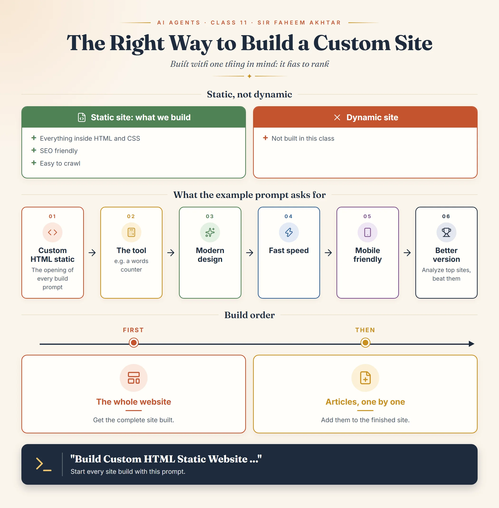

*This whole document is from Class 11 of the AI Agents module, Right Way to
Build Custom Site, taught by Sir Faheem Akhtar.*

## Build it to rank

Every custom site in this class is built with one thing in mind: **it has
to rank**.[^ai-agents-class-11]

## Static, not dynamic

The sites we build are **static sites**: everything is built inside **HTML
and CSS**. We do not build dynamic sites.[^ai-agents-class-11]

The reason the class gives, static sites are:[^ai-agents-class-11]

- **SEO friendly**, and
- **easy to crawl**.

The notes do not describe dynamic sites beyond saying not to build them.

## The prompt to start with

Whenever you start building a site, begin the prompt with:

```text
Build Custom HTML Static Website ...
```

A full example from the class, for a words counter tool:[^ai-agents-class-11]

```text
Build Custom HTML Static Website, build words counter. Make sure design is
modern, speed is fast, it is mobile friendly. Analyze top sites and build
better version of them
```

What the example asks for, point by point:

1. **Custom HTML static website**: the opening that sets the build type.
2. **The tool**: here, a words counter.
3. **Modern design.**
4. **Fast speed.**
5. **Mobile friendly.**
6. **Analyze the top sites and build a better version of them.**

Swap the words counter for your own tool and keep the rest. The same
competitor rule appears in
[Class 10](small-web-tools-with-ai.md): analyse the competitors and leave
none of their gaps in your site.

## Whole site first, then articles

First get the **whole website** built. Then add **articles** to it **one
by one**.[^ai-agents-class-11]

## Class infographic



[^ai-agents-class-11]: iSkills AI Agents Session 11 notes, Right Way to
    Build Custom Site, taught by Sir Faheem Akhtar.
