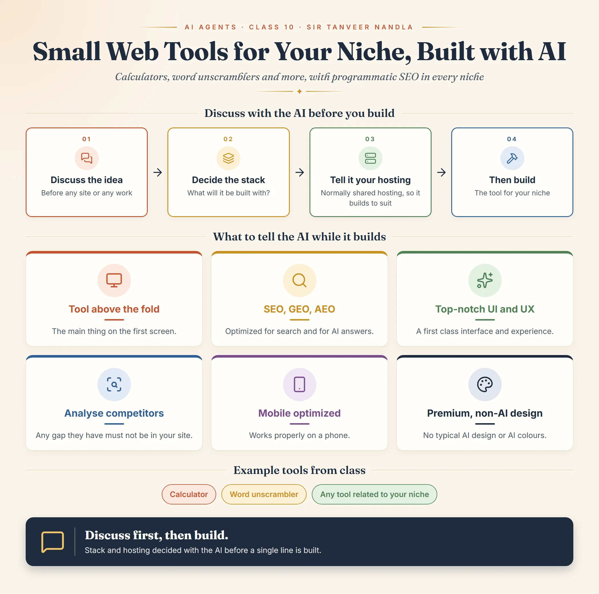

*This whole document is from Class 10 of the AI Agents module, Small Web
Based Project with use cases, taught by Sir Tanveer Nandla.*

## What the class builds

In this class, small tools are built with AI, each related to your own
niche: for example a **calculator** or a **word
unscrambler**.[^ai-agents-class-10]

Whatever niche you are working on, **programmatic SEO** will be part of
it.[^ai-agents-class-10] A tool page is a natural fit for that: one tool
template can serve many keyword variations. For how programmatic SEO
templates work, see
[Content coverage, Class 1](../keyword-research-and-content-planning/content-coverage/content-coverage-related-keywords-and-programmatic-seo.md).

## Discuss with the AI before you build

Before building any site, or working on anything, first **discuss it with
the AI**.[^ai-agents-class-10] The order the class gives:

1. **Discuss the idea** of what you are building with the AI.
2. **Decide the stack**: discuss with the AI what the stack of the thing
   you are building will be.
3. **Tell it your hosting.** We will normally work on **shared hosting**,
   so tell the AI which hosting you are working on. It will then build the
   tool to suit that hosting.
4. **Then build.**

## What to tell the AI while it builds

While the tool is being built, tell the AI all of these as
requirements:[^ai-agents-class-10]

| Requirement | What it means for the tool |
| --- | --- |
| Main thing above the fold | The tool itself shows on the first screen, before any scrolling |
| SEO, GEO and AEO optimized | Optimized for search engines and for AI and answer engines |
| Top-notch UI and UX | The interface and the experience are first class |
| Competitor analysis | Analyse competitors; any gap you find in them must not be in your site |
| Mobile optimized | The tool works properly on a phone |
| Premium, non-AI design | Do not use a typical AI design or typical AI colours |

The above the fold rule is the same one taught for content: fulfil the
page's main intent on the first screen. A tool keyword such as "image
resizer online" is fulfilled by a working tool the visitor can use right
away; see
[Starting content writing, Class 5](../content-writing/writing-fundamentals/content-writing-above-the-fold-class-5.md).

### Putting it into one prompt

The class gives these as points rather than as one written prompt. Put
together, a build prompt carrying every point looks like this (replace the
tool, niche and hosting with your own):

```text
Build a [tool name] for my [niche] website. I host on shared hosting
([hosting name]). Put the main tool above the fold. Make it SEO, GEO and
AEO optimized, with top-notch UI and UX, and fully mobile optimized.
Analyse the top competitor tools first; if they have any gap, make sure
my tool does not have it. The design must be premium and non-AI: do not
use a typical AI design or typical AI colours.
```

## Open question

The notes end with an unfinished point: "the UI in which you want to build
your tool". What the class said about choosing that UI is not in the notes.

## Class infographic



[^ai-agents-class-10]: iSkills AI Agents Session 10 notes, Small Web Based
    Project with use cases, taught by Sir Tanveer Nandla.
