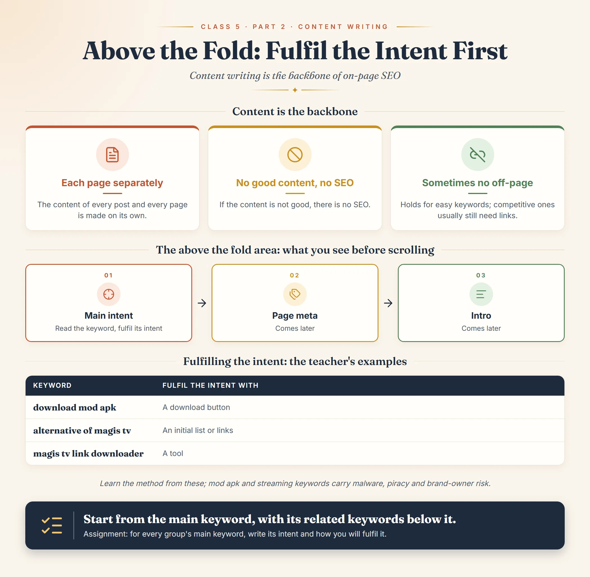

*This chapter records the content writing part of Class 5 of the SEO module,
taught by Ammar Ashfaq. The first part of the class, on keywords in other
languages, is in
[Keyword coverage and grouping, Class 5](../../keyword-research-and-content-planning/grouping-and-site-structure/keyword-coverage-other-languages-class-5.md).*[^seo-class-05]

## Content is the backbone

After keyword research, grouping and site structure, the class moves to
content writing.

- The content of every post and every page is made separately.
- In on-page SEO, content writing is the **backbone**. If the content is not
  good, there is no SEO.
- If the content is good, sometimes off-page SEO is not even
  needed.[^seo-class-05]

> [!NOTE]
> The infographic adds a reality check: skipping off-page can hold for easy
> keywords, but for competitive keywords backlinks and brand mentions usually
> still matter, so test it on your own site first.[^seo-class-05-infographic]

## How to start

First take the **main keyword**, and below it write its **related keywords**.
Content writing starts on the basis of that list.[^seo-class-05] The main
keyword and its related keywords are the groups built in
[Class 4](../../keyword-research-and-content-planning/grouping-and-site-structure/content-coverage-and-grouping-class-4.md).

## Above the fold

When a page opens, the area or content you see before scrolling is called the
**above the fold area**. It is the most important part of the content, and it
holds three things:

1. **Main intent of the page**
2. **Page meta**
3. **Intro**[^seo-class-05]

Read your keyword to find its intent; your job is to fulfil that intent.
Page meta and the intro come later.[^seo-class-05]

## Fulfilling the intent: the teacher's examples

| Keyword | Fulfil the intent with |
| --- | --- |
| download mod apk | A download button |
| alternative of magis tv | An initial list or links |
| magis tv link downloader | A tool |

These three keywords are the teacher's own examples.[^seo-class-05]

The infographic shows the same idea with its own keywords: "download pdf
editor" with a clear download button on the first screen, "alternative of
canva" with an initial list or links of the alternatives, and "image resizer
online" with a working tool the visitor can use right
away.[^seo-class-05-infographic]

> [!CAUTION]
> The teacher's examples are mod apk and streaming app keywords. As noted in
> Class 4, such keywords can carry malware, piracy and brand-owner risk; use
> them to learn how intent is fulfilled, not as a niche to build.

## Assignment

For every group's main keyword, write what its intent is and how you will
fulfil it.[^seo-class-05] This is step 4 of the Class 5 assignment; the first
three steps (find your niche's keywords, group them, build the site
structure) are in the keyword part of the class.

[^seo-class-05]: SEO module Class 5 notes supplied by Ahmed Raza on
    2026-11-05, Keyword Coverage & Grouping, taught by Ammar Ashfaq.

[^seo-class-05-infographic]: Content Writing infographic, Part 2 of Class 5,
    supplied by Ahmed Raza on 2026-11-05.

## Class infographic

