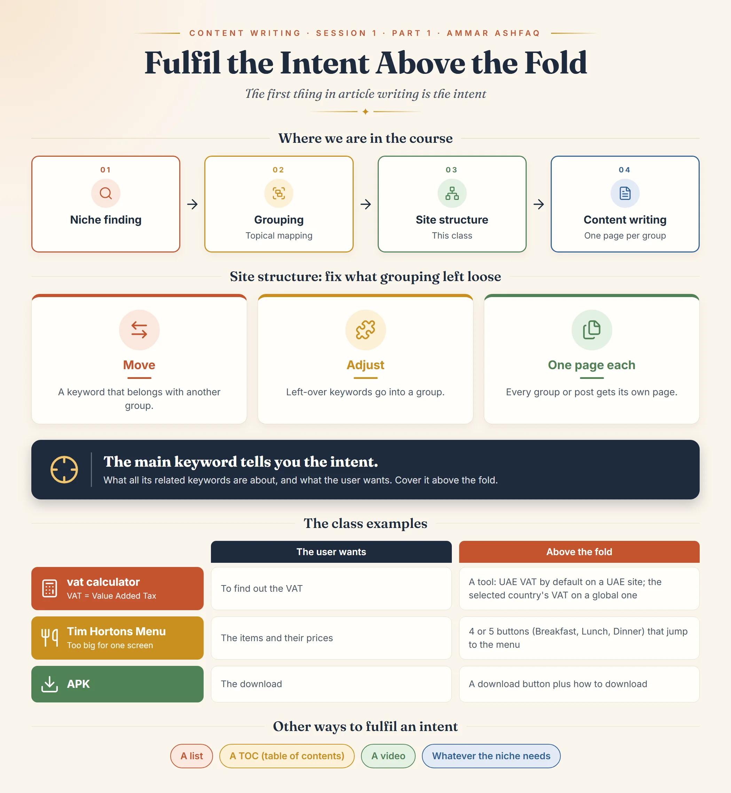
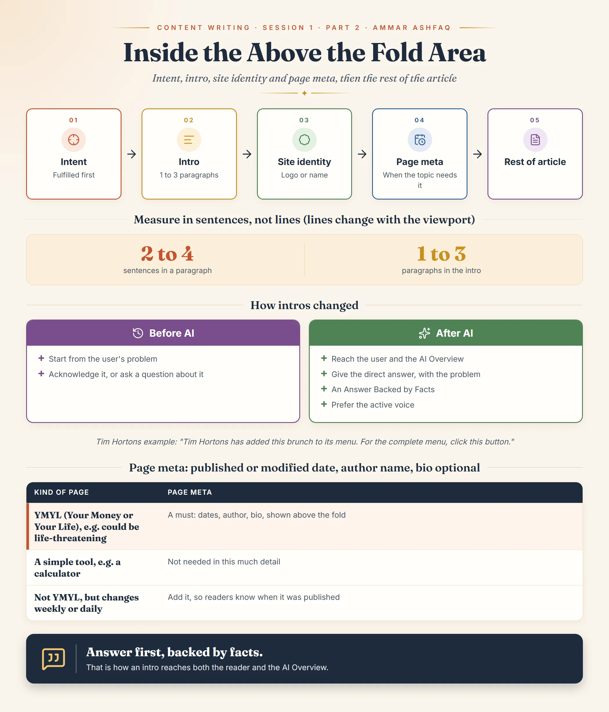
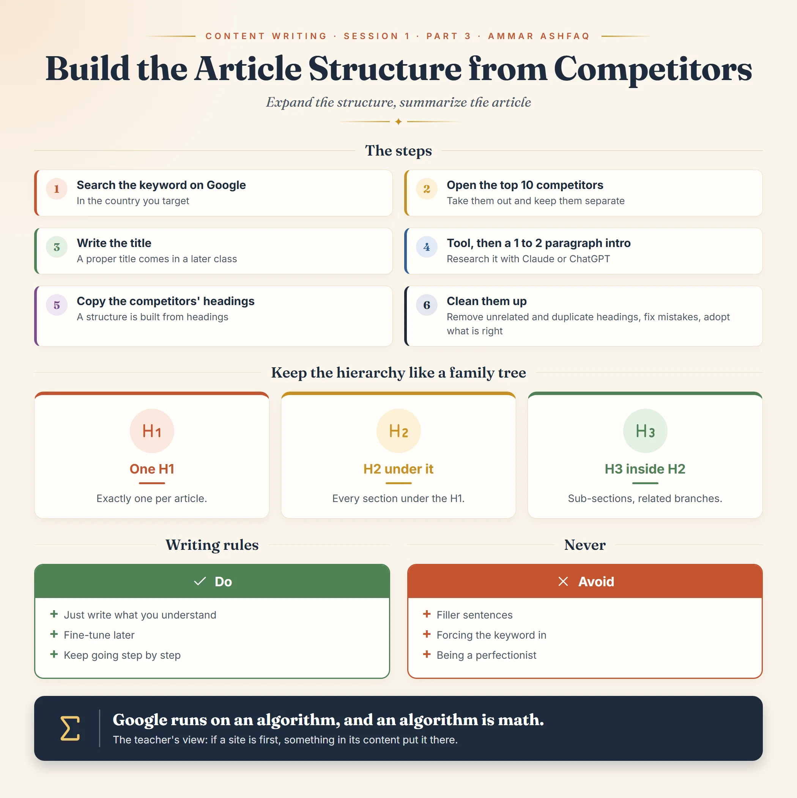

*This chapter records Session 1 of Content Writing in the SEO module, taught
by Ammar Ashfaq. It builds on
[Starting content writing, Class 5](content-writing-above-the-fold-class-5.md),
which first introduced the above the fold area.*

## Where we are in the course

So far the course has taught that SEO starts with **niche finding**,
followed by **grouping**, also called topical
mapping.[^content-writing-session-01] For those steps, see
[Content coverage and grouping, Class 4](../../keyword-research-and-content-planning/grouping-and-site-structure/content-coverage-and-grouping-class-4.md).

The next step is to define the **site structure**. Understanding the
concept matters most here, because in SEO everything is
conceptual.[^content-writing-session-01]

## Site structure: one page per group

The purpose of site structure is to fix what grouping left loose:

- sometimes a keyword in one group feels like it belongs with **another
  group**, so you move it;
- sometimes some keywords are **left over**, so you adjust them into a
  group.[^content-writing-session-01]

Once that is done, **every group, or every post you took out, gets its own
separate page**.[^content-writing-session-01]

## The main keyword tells you the intent

The **main keyword** of a group tells you what all of its related keywords
are talking about, and what the **intent** is. For every main keyword, or
every page, the intent must be clear: what does the user want from
it?[^content-writing-session-01]

Once the intent is final, you build the article, and the intent **must be
covered above the fold**.[^content-writing-session-01] **The first thing in
article writing is to take care of the intent and fulfil
it.**[^content-writing-session-01]

### The class examples

| Niche or main keyword | What the user wants | How to fulfil it above the fold |
| --- | --- | --- |
| **vat calculator** | To find out the VAT (Value Added Tax) | Build a **tool**. For a UAE site, show the UAE VAT by default; for a global site, show the VAT of whichever country the user selects |
| **Tim Hortons Menu** | Only to see what is on the menu and the prices: the items and their prices | The full menu cannot fit above the fold, so put **4 or 5 buttons** there, such as Breakfast, Lunch and Dinner. A click takes the user to that menu, and they are sure what they want is here |
| **APK** | The download | A **download button** plus **how to download** |

In the same way, depending on the niche, fulfil the intent with a **list**
in one place, a **TOC** (table of contents) in another, a **video** in
another, or something else.[^content-writing-session-01]

## What goes above the fold

The above the fold area is the start of the article. In this class it
holds:[^content-writing-session-01]

1. **Intent**: fulfilled, as above.
2. **Intro**: sometimes one paragraph, sometimes two.
3. **Site identity**: the site's logo or name.
4. **Page meta**: when the topic needs it (see below).

Then comes **the rest of the article**.

### How long is an intro?

How many lines a paragraph takes changes with the **viewport**, so lines are
not the measure. Count **sentences** instead:[^content-writing-session-01]

| Unit | The class rule |
| --- | --- |
| One paragraph | **2 to 4 sentences** |
| The intro | **1 to 3 paragraphs** |

(The notes also say the intro is "sometimes 1 paragraph or sometimes 2" in
one place and "1 to 3 paragraphs" in another; both are as taught, and 1 to 3
is the wider rule.)

### How to write the intro: answer first, backed by facts

**Before AI**, an intro started from the user's problem: having understood
it from the intent, you would acknowledge the problem, or ask the user a
question about it.[^content-writing-session-01]

**After AI**, content writing has changed a little. Now you have to reach
not only the user but also the **AI Overview**. So you no longer just talk
about the problem: you give the **direct answer**, which is the AI's own
way.[^content-writing-session-01]

So the intro now pairs the problem with a **straight answer**, and that
answer must be **backed by facts**: an *Answer Backed by
Facts*.[^content-writing-session-01]

An intro for a Tim Hortons menu page would run something like: *"Tim Hortons
has added this brunch to its menu. For the complete menu, click this
button."*[^content-writing-session-01]

**Prefer the active voice** in the intro. The passive voice also works, but
active is preferable.[^content-writing-session-01]

### Page meta, and when it is a must

**Page meta** means the **published or modified date** and the **author's
name**; the **author's bio** is optional.[^content-writing-session-01] Page
meta follows the article: somewhere it is a must, somewhere it is not
needed at all.

| Kind of page | Page meta |
| --- | --- |
| **YMYL** (Your Money or Your Life) topic, such as an article that could be life-threatening if wrong | **A must**: published and modified date, author name and bio, all of it, and shown **above the fold** |
| A simple tool, such as a calculator, that is not life-threatening | Not needed in this much detail |
| **Exception:** not YMYL, but the niche **changes every week or every day** | Add page meta, so the reader knows when it was published |

In short, page meta is a must for YMYL niches, and it is shown above the
fold.[^content-writing-session-01]

## Building the article structure

1. **Search your keyword on Google**, in the same **country** you are
   targeting.
2. **Open the top 10 competitors' sites** so you can analyse them. Take
   them out and keep them separate.
3. **Write the title.** How to write a proper title comes in a later class.
4. **Under the title, put the tool** (or whatever fulfils the intent), and
   under it a **1 to 2 paragraph intro**. You can research the information
   for it with **Claude** or **ChatGPT**.
5. **Build the rest of the structure from the competitors.** A structure is
   built from **headings**: copy the competitors' headings
   directly.[^content-writing-session-01]

### Clean up the copied headings

- If a heading is **not related** to your site, remove it.
- If the same heading appears **two or three times under different names**,
  keep it once.
- **Fix their mistakes**, and **adopt what they got
  right**.[^content-writing-session-01]

The headings are the starting skeleton; the words under them are still
yours to write.

### Expand the structure, summarize the article

Keep this line in mind while building the structure: **"Expand the
structure, summarize the article."** Its first half means every **unique
heading** you find goes into your article: bring in everything you can.
[^content-writing-session-01]

### Keep the hierarchy like a family tree

A structure is **organized**, never messy. It works like a **family tree**:
parents on top, their children under them, with proper branches that relate
to each other.[^content-writing-session-01]

| Level | Rule |
| --- | --- |
| **H1** | Exactly **one** per article |
| **H2** | Every section under the H1 |
| **H3** | Every sub-section inside an H2 |

Maintain this hierarchy throughout the article.[^content-writing-session-01]
For more on headings, see
[Article structure: headings, competitor analysis, and keyword prominence](article-writing-and-seo-structure.md).

## Writing rules from the class

- **Just write.** Write what you understand; fine-tuning comes later.
- **Never add filler sentences.**
- **Never force the keyword in.** It should come in naturally, where it
  relates to the content.
- **Don't be a perfectionist.** Keep doing as much as you can, step by
  step.[^content-writing-session-01]

## Why copying the winner's structure works

The teacher's reasoning: Google runs on an **algorithm**, and an algorithm
is **math**, where 1 + 1 is always 2. So if a site is first, there is
something in its content that made Google put it
first.[^content-writing-session-01] This is the teacher's explanation of
why competitor analysis works, not a published Google rule.

## Class infographics

[^content-writing-session-01]: Content Writing Session 01 notes, SEO
    module, taught by Ammar Ashfaq, supplied by the record's owner on
    2026-11-17.
