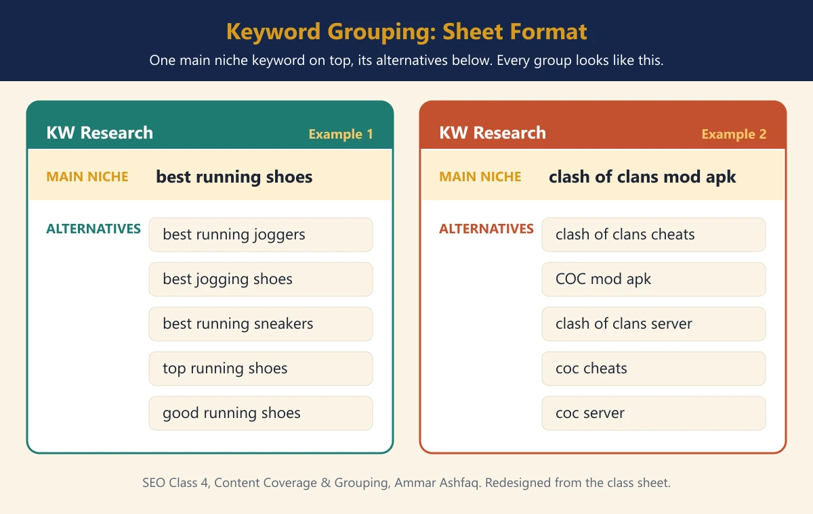
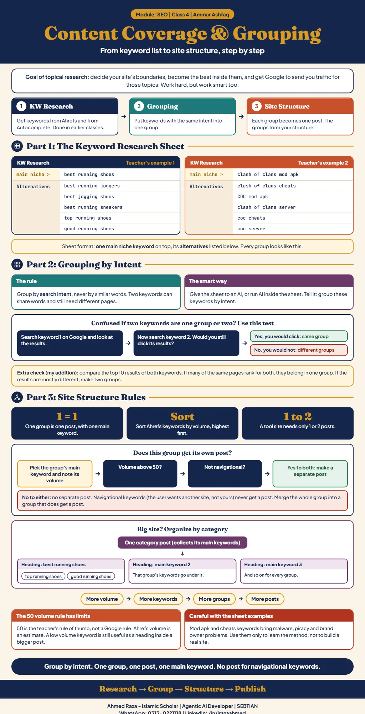

*This chapter records Class 4 of the SEO module, Content Coverage &
Grouping, taught by Ammar Ashfaq.*[^seo-class-04]

## Topical research

Work hard, but work smart too. In SEO, the important topic after keyword
research is **topical research**, meaning research into topics. Its main
purpose is for Google to send your site traffic related to those topics. You
decide your site's boundaries and become the best inside
them.[^seo-class-04]

The process has three steps:

1. **Keyword research.** Covered in the earlier classes: getting keywords from
   Ahrefs and from Google Autocomplete.
2. **Grouping.**
3. **Site structure.**[^seo-class-04]

For the earlier keyword work, see
[Class 1](content-coverage-related-keywords-and-programmatic-seo.md) and
[Class 2](content-coverage-competitors-and-keyword-grouping.md).

## The keyword research sheet

The class showed the sheet format each group takes: one **main niche**
keyword at the top and its **alternatives** listed
below.[^seo-class-04]

| | Example 1 | Example 2 |
| --- | --- | --- |
| Main niche | best running shoes | clash of clans mod apk |
| Alternatives | best running joggers, best jogging shoes, best running sneakers, top running shoes, good running shoes | clash of clans cheats, COC mod apk, clash of clans server, coc cheats, coc server |

The image above is a redesign of the screenshot shown in class; the keywords
are unchanged.[^seo-class-04]

> [!CAUTION]
> The infographic notes that mod apk and cheats keywords bring malware,
> piracy and brand-owner problems. Use the second example only to learn the
> method, not to build a real site.[^seo-class-04-infographic]

## Grouping by intent

After collecting the keyword and its related keywords, group them.

- Group by **intent**, not on the basis of the words.
- The best way is to give the sheet to an AI, or run AI inside the sheet, and
  tell it to group the keywords on the basis of intent.[^seo-class-04]

**When two keywords confuse you.** If you cannot tell whether two keywords
belong in the same group, search the first one, then the second. If you would
not click the second keyword's results after searching the first, they are
different groups.[^seo-class-04]

The infographic adds one more check that is not in the class notes: compare
the top 10 results of both keywords. If many of the same pages rank for both,
they belong in one group; if the results are mostly different, make two
groups.[^seo-class-04-infographic]

## From groups to site structure

- **Every group means one post**, and every group has one main keyword.
- Separate out the main keywords and build the site structure from them.
- When you take keywords out of Ahrefs, sort them by
  volume.[^seo-class-04]

### Does a group get its own post?

Write down each main keyword and note next to it whether it gets a separate
post.[^seo-class-04]

| Condition | Separate post? |
| --- | --- |
| Main keyword volume **above 50** | Yes |
| Main keyword volume **below 50** | No |
| **Navigational** keyword, where the user wants to go to some other site, not yours | No |

The keywords that cannot get their own post are not thrown away. Adjust that
whole group into the groups that do get a separate post. This gives the final
grouping, and that is the site's structure.[^seo-class-04]

> [!NOTE]
> The 50 volume line is the teacher's rule of thumb, not a Google rule. The
> infographic adds that Ahrefs volume is an estimate, and that a low volume
> keyword is still useful as a heading inside a bigger
> post.[^seo-class-04-infographic] The notes do not say what to do with a main
> keyword whose volume is exactly 50.

### A big site: organise by category

If there are a lot of main keywords and their volume is also high, build the
site structure by **category**:

1. The main keyword the site is built on stays separate.
2. Sort every other main keyword into categories.
3. Each category gets its own post. Every main keyword in that category becomes
   a heading in the post, and that group's keywords go under its
   heading.[^seo-class-04]

The notes do not say how many main keywords make a site "big", or how to
choose the categories.

### Size depends on volume

- A **tool site** needs only 1 or 2 posts.
- More volume means more keywords; more keywords means more groups; and more
  groups means more posts.[^seo-class-04]

[^seo-class-04]: SEO module Class 4 notes and keyword sheet screenshot,
    supplied by Ahmed Raza on 2026-11-02, Content Coverage & Grouping, taught
    by Ammar Ashfaq.

[^seo-class-04-infographic]: Content Coverage & Grouping infographic,
    supplied by Ahmed Raza on 2026-11-02.

## Class infographic

