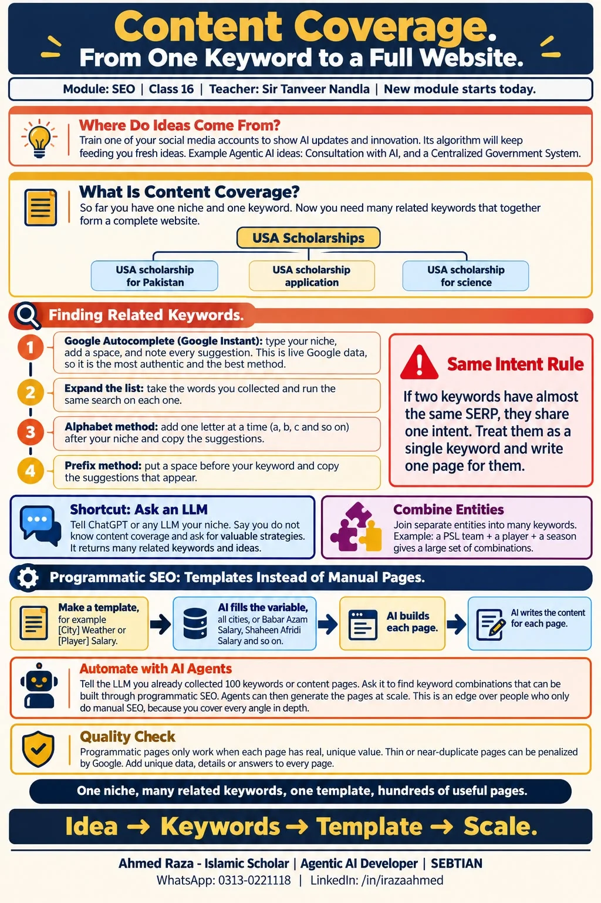

*This whole document is from Class 1 of Content Coverage in the SEO module,
taught by Sir Tanveer Nandla.*

## Where ideas come from

Students often ask where ideas will come from. The best way is to train the
**algorithm** of one of your **social media platforms** on **AI updates and
innovation**. The best ideas come from there.[^content-coverage-class-01]

Some ideas for **agentic AI**:

- **Consultation with AI**
- **Government centralized system**[^content-coverage-class-01]

## From one keyword to a whole website

- So far we have a **niche**, one **keyword**.
- Now we need **related keywords** that together make up a **whole
  website**.
- For example, if the niche is **"USA Scholarships"**, it gives many related
  keywords: *usa scholarship for Pakistan*, *usa scholarships application*,
  *usa scholarships for science*, and so on.
- Collect all these related keywords in **one place**, then write content
  on them.
- The related keywords come from **keyword research**.[^content-coverage-class-01]

## Keyword research with Google Autocomplete

**Google Instant / Google Autocomplete** uses Google's **live, up-to-date**
data, so it is more **authentic** and **actionable**. It is the **best**
method of keyword research:[^content-coverage-class-01]

1. Write your niche on Google and just press **space**. The suggestions that
   come up are **related keywords**.
2. **Expand** the research with the words you have taken out.
3. Then write the alphabet one letter at a time and **copy** the
   suggestions.
4. Then put a **space at the start** of the keyword, and copy and save the
   suggestions.[^content-coverage-class-01]

> [!IMPORTANT]
> If two related keywords have the **same intent**, meaning their **SERPs
> are almost the same**, treat them as **one keyword**.[^content-coverage-class-01]

## A new idea: ask an LLM

Tell ChatGPT or any LLM that you are going to work on this niche, that you
do not know content coverage, and ask it for valuable strategies. It gives
you multiple related keywords and a lot of ideas.[^content-coverage-class-01]

## Automation with AI agents

- Prompt an LLM: you have taken out **100 content pages** or keywords. Can
  it find keyword **combinations** that can be built through **programmatic
  SEO**?
- These combinations give you an **edge** over others doing SEO.
- You can also take out many keywords by **combining multiple entities**.
  If one entity is **PSL**, another is a **plate's name** and another is a
  **season**, combining them gives many combinations.[^content-coverage-class-01]

## Programmatic SEO

- What you do not do **manually**, you make a **template** for, such as
  **[City] Weather**.
- Agentic AI writes every city in place of *City*, builds a page for each
  and writes the content.
- Another template: **[Player] Salary**. Agentic AI builds *Babar Azam
  Salary*, *Shaheen Afridi Salary*, and so on.
- The LLM builds these combinations itself.
- So now we do not do only normal SEO but **programmatic SEO**, covering
  every single thing **in depth**.
- When manual SEO gets the touch of programmatic SEO, nobody will come
  close.[^content-coverage-class-01]

[^content-coverage-class-01]: iSkills SEO Content Coverage Class 1 notes, taught by
    Sir Tanveer Nandla.

## Class infographic

