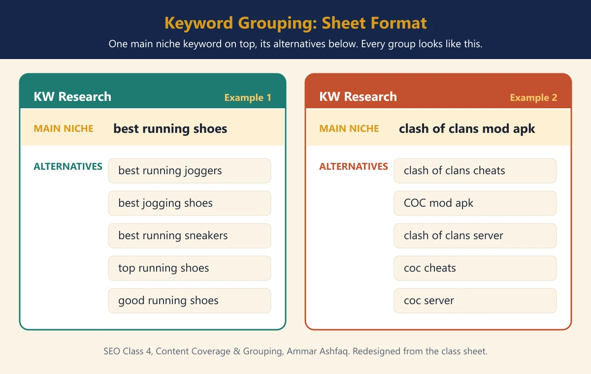
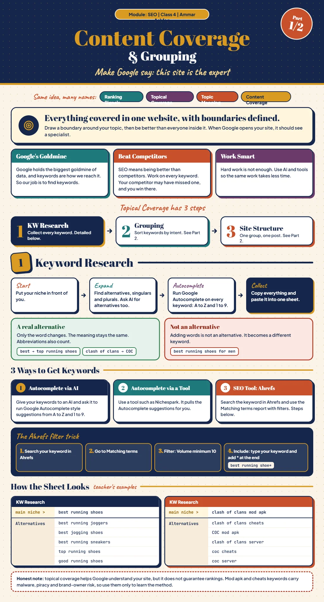
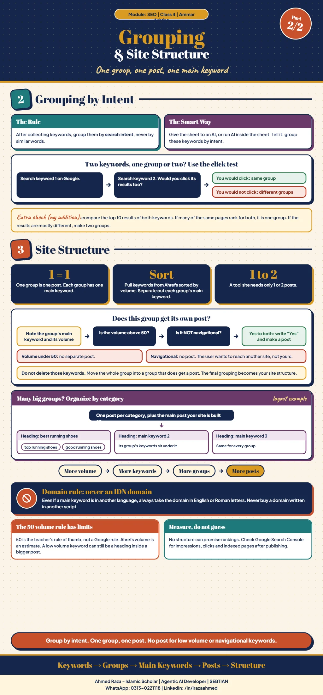

*This chapter records Class 4 of the SEO module, Content Coverage &
Grouping, taught by Ammar Ashfaq.*[^seo-class-04]

## Topical coverage: what the class is after

Everything done in SEO is aimed at **ranking signals**. The class says the
same idea goes by several names: topical coverage, topic mapping and content
coverage.[^seo-class-04]

The goal is that whenever Google opens your site, it should see a specialist,
an expert in that topic and field, with everything about the topic covered.
In the class's words, the aim is **everything covered in a single website,
with boundaries defined**: you decide your site's boundaries and become the
best inside them, so that no one covers that topic better than
you.[^seo-class-04]

Work hard, but work smart too. After keyword research, the important topic in
SEO is **topical research**, meaning research into topics. Its main purpose
is for Google to send your site traffic related to those
topics.[^seo-class-04]

### Why keywords

Google's biggest goldmine is data, and keywords are how you reach it, so the
job is to find keywords. The main work of SEO is being better than your
competitors, so work on every single keyword. A competitor may have missed a
keyword, and you can beat them there.[^seo-class-04]

### The three steps

Topical coverage has three steps:

1. **Keyword research.** Covered in the earlier classes (getting keywords from
   Ahrefs and Google Autocomplete) and expanded below.
2. **Grouping.**
3. **Site structure.**[^seo-class-04]

For the earlier keyword work, see
[Class 1](../content-coverage/content-coverage-related-keywords-and-programmatic-seo.md) and
[Class 2](../content-coverage/content-coverage-competitors-and-keyword-grouping.md).

> [!NOTE]
> The infographic adds that topical coverage helps Google understand your
> site but does not guarantee rankings.[^seo-class-04-infographic]

## Step 1: keyword research

1. **Start** with your niche in front of you.
2. **Expand** it: find its alternatives, singulars and plurals, and ask AI
   for more alternatives.
3. **Autocomplete:** run Google Autocomplete on every keyword you now have,
   A to Z and 1 to 9.
4. **Collect:** copy all of it and paste it into one sheet.[^seo-class-04]

### What counts as an alternative

An alternative is a keyword where **the word changes but the meaning stays
the same**. Adding words to a keyword does not make an alternative.
Abbreviations can also be listed as alternatives.[^seo-class-04]

| Keyword | Alternative? |
| --- | --- |
| best running shoes → top running shoes | Yes, only the word changed |
| clash of clans → COC | Yes, an abbreviation |
| best running shoes → best running shoes for men | No, words were added |

The examples in this table are taken from the class
infographic.[^seo-class-04-infographic]

### Three ways to get keywords

1. **Google Autocomplete via AI.** Ask an AI to produce the Autocomplete
   suggestions.
2. **Google Autocomplete via a tool**, such as NicheSpark.
3. **An SEO tool:** Ahrefs.[^seo-class-04]

For the tool, see
[NicheSpark: Chrome extension for Google Autocomplete keyword research](../keyword-research/nichespark-autocomplete-keyword-tool.md).

### The Ahrefs filter method

Another strong way to collect keywords:

1. Search your keyword in Ahrefs.
2. Go to **Matching keywords**.
3. Add a filter for a **minimum volume of 10**.
4. In **Include**, type your main keyword and put `*` at the end. For the
   keyword "best running shoes", type `best running shoe*`.[^seo-class-04]

### The keyword research sheet

The class showed the sheet format each group takes: one **main niche**
keyword at the top and its **alternatives** listed
below.[^seo-class-04]

| | Example 1 | Example 2 |
| --- | --- | --- |
| Main niche | best running shoes | clash of clans mod apk |
| Alternatives | best running joggers, best jogging shoes, best running sneakers, top running shoes, good running shoes | clash of clans cheats, COC mod apk, clash of clans server, coc cheats, coc server |

The image above is a redesign of the screenshot shown in class; the keywords
are unchanged.[^seo-class-04]

> [!CAUTION]
> The infographic notes that mod apk and cheats keywords carry malware,
> piracy and brand-owner risk. Use the second example only to learn the
> method, not to build a real site.[^seo-class-04-infographic]

## Step 2: grouping by intent

After collecting the keyword and its related keywords, group them.

- Group by **intent**, not on the basis of the words.
- The best way is to give the sheet to an AI, or run AI inside the sheet, and
  tell it to group the keywords on the basis of intent.[^seo-class-04]

**The click test.** If you cannot tell whether two keywords belong in the
same group, search the first one, then the second. If you would not click the
second keyword's results after searching the first, they are different
groups.[^seo-class-04]

The infographic adds one more check that is not in the class notes: compare
the top 10 results of both keywords. If many of the same pages rank for both,
they belong in one group; if the results are mostly different, make two
groups.[^seo-class-04-infographic]

## Step 3: site structure

- **Every group means one post**, and every group has one main keyword.
- Separate out the main keywords and build the site structure from them.
- When you take keywords out of Ahrefs, sort them by
  volume.[^seo-class-04]

### Does a group get its own post?

Write down each main keyword and note next to it whether it gets a separate
post.[^seo-class-04]

| Condition | Separate post? |
| --- | --- |
| Main keyword volume **above 50** | Yes |
| Main keyword volume **below 50** | No |
| **Navigational** keyword, where the user wants to go to some other site, not yours | No |

The keywords that cannot get their own post are not thrown away. Adjust that
whole group into the groups that do get a separate post. This gives the final
grouping, and that is the site's structure.[^seo-class-04]

> [!NOTE]
> The 50 volume line is the teacher's rule of thumb, not a Google rule. The
> infographic adds that Ahrefs volume is an estimate, and that a low volume
> keyword can still be a heading inside a bigger
> post.[^seo-class-04-infographic] The notes do not say what to do with a main
> keyword whose volume is exactly 50.

### A big site: organise by category

If there are a lot of main keywords and their volume is also high, build the
site structure by **category**:

1. The main keyword the site is built on stays separate.
2. Sort every other main keyword into categories.
3. Each category gets its own post. Every main keyword in that category becomes
   a heading in the post, and that group's keywords go under its
   heading.[^seo-class-04]

The notes do not say how many main keywords make a site "big", or how to
choose the categories.

### Size depends on volume

- A **tool site** needs only 1 or 2 posts.
- More volume means more keywords; more keywords means more groups; and more
  groups means more posts.[^seo-class-04]

### Domain rule: never an IDN domain

If a main keyword in your site structure is in another language, never take
the domain in that language. Always take the domain in English or Roman
letters. Never take an IDN domain.[^seo-class-04]

### After publishing

No structure can promise rankings. The infographic suggests checking Google
Search Console for impressions, clicks and indexed pages after
publishing.[^seo-class-04-infographic]

[^seo-class-04]: SEO module Class 4 notes, updated 2026-11-03, and the class
    keyword sheet screenshot, supplied by Ahmed Raza; Content Coverage &
    Grouping, taught by Ammar Ashfaq.

[^seo-class-04-infographic]: Content Coverage & Grouping infographic, Parts 1
    and 2, supplied by Ahmed Raza on 2026-11-03.

## Class infographic

