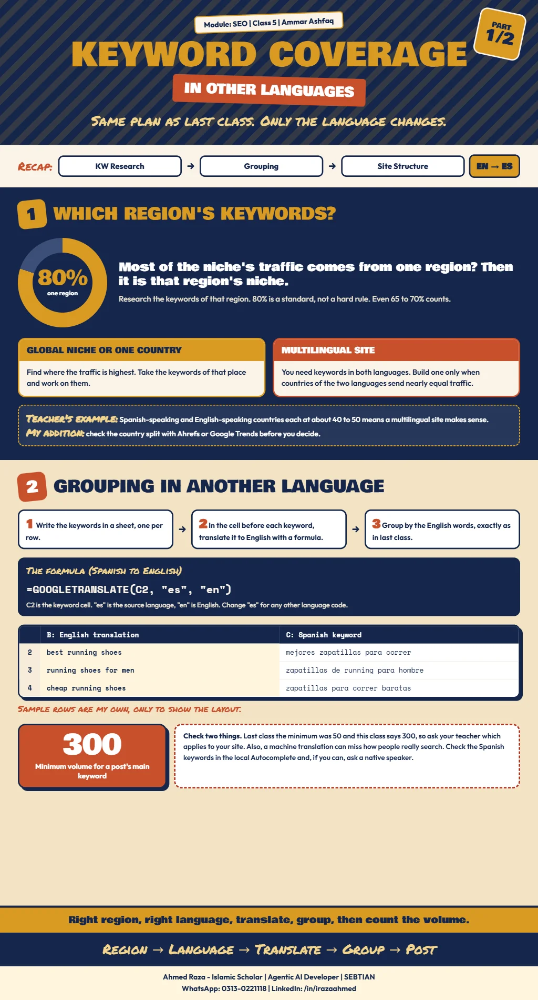

*This chapter records Class 5 of the SEO module, Keyword Coverage &
Grouping, taught by Ammar Ashfaq.*[^seo-class-05]

The keyword research and content planning from the
[last class](content-coverage-and-grouping-class-4.md) is done again here in
another language. The concepts are all the same.[^seo-class-05]

The second half of the class starts content writing; it is recorded in
[Starting content writing: the above the fold area and fulfilling search intent](../../content-writing/writing-fundamentals/content-writing-above-the-fold-class-5.md).

## Which region's keywords?

- If around **80%** of a niche's traffic comes from one region, it is that
  region's niche, and you take that region's keywords. 80% is a standard, not
  a hard and fast rule: even 65 or 70% still makes it that region's niche.
- For a global niche, or a niche of one specific country, find where the
  traffic is highest and work on the keywords from there.[^seo-class-05]

The infographic adds a suggestion that is not in the class notes: check the
country split with Ahrefs or Google Trends before you
decide.[^seo-class-05-infographic]

### When to build a multilingual site

- If you build a site as **multilingual**, you have to take out keywords in
  both languages.
- Build a multilingual site when the countries of the two languages send
  almost the same traffic. The teacher's example: Spanish-speaking countries
  and English-speaking countries each at a volume of around 40 to
  50.[^seo-class-05]

The notes do not say whether "40 50" is a percentage share of traffic or a
search volume figure.

## Grouping in another language

1. Write the keywords in a sheet, the same way as before.
2. In the cell before each keyword, write a formula that translates it from
   the source language into English. From Spanish to English:

   ```text
   =GOOGLETRANSLATE(C2, "es", "en")
   ```

3. Group on the basis of the translated words, as taught in the last
   class.[^seo-class-05]

In the formula, `C2` is the keyword's cell, `"es"` is the source language and
`"en"` is English; change `"es"` for another language's
code.[^seo-class-05-infographic]

| | B: English translation | C: Spanish keyword |
| --- | --- | --- |
| 2 | best running shoes | mejores zapatillas para correr |
| 3 | running shoes for men | zapatillas de running para hombre |
| 4 | cheap running shoes | zapatillas para correr baratas |

These sample rows come from the infographic and only show the layout; they
are not from the class.[^seo-class-05-infographic] The infographic also
warns that a machine translation can miss how people really search, so check
the keywords in the local Autocomplete and, if you can, with a native
speaker.[^seo-class-05-infographic] See also
[Multilingual keyword and content workflow](../../content-writing/advanced-content-techniques/multilingual-keyword-and-content-workflow.md).

### Minimum volume for a post

The **main keyword of a post should have a minimum volume of
300**.[^seo-class-05]

> [!WARNING]
> Class 4 gave the separate-post line as a main keyword volume **above 50**;
> this class says a **minimum of 300**. The notes do not say whether 300
> applies only to other-language sites or replaces 50 everywhere. Both
> figures are recorded as taught; ask the teacher which applies to your site.

## Assignment

1. Find the keywords of your niche.
2. Group them.
3. Build the site structure.
4. For every group's main keyword, write what its intent is and how you will
   fulfil it.[^seo-class-05] How to find and fulfil the intent is explained in
   [the content writing part of this class](../../content-writing/writing-fundamentals/content-writing-above-the-fold-class-5.md).

[^seo-class-05]: SEO module Class 5 notes supplied by Ahmed Raza on
    2026-11-05, Keyword Coverage & Grouping, taught by Ammar Ashfaq.

[^seo-class-05-infographic]: Keyword Coverage in Other Languages
    infographic, Part 1 of Class 5, supplied by Ahmed Raza on 2026-11-05.

## Class infographic


