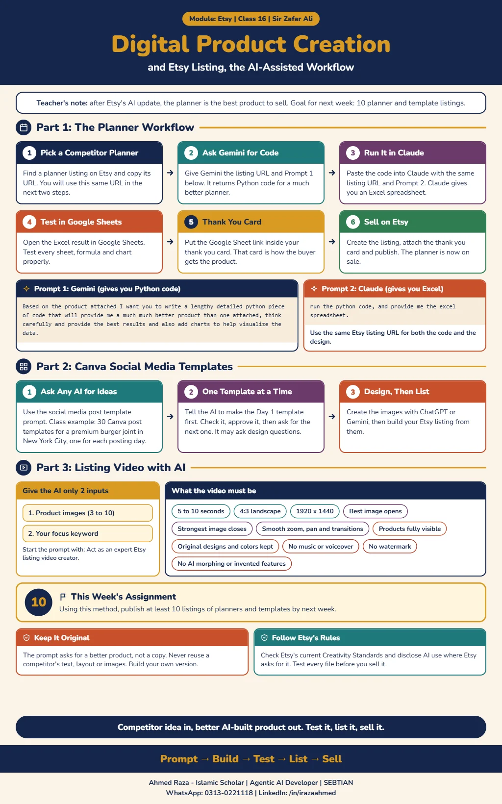

*This document records Class 16 of the Etsy module, Digital Product Creation
and Etsy Listing, taught by Sir Zafar Ali.*[^etsy-class-16]

## Why planners

According to the class, after Etsy's AI update the best product to sell is the
**planner**.[^etsy-class-16] This is the instructor's market judgement. The
notes do not describe what the AI update changed or give sales data behind the
claim, so treat it as advice to test in your own shop.

## The planner workflow: Gemini, then Claude

1. **Pick a competitor planner.** Find a planner listing on Etsy and copy its
   URL. You will give this same URL in the next two steps.
2. **Ask Gemini for code.** Give Gemini the competitor's listing URL with
   Prompt 1 below. Gemini returns Python code for a better planner.
3. **Run it in Claude.** Paste that Python code into Claude, together with the
   same listing URL, and give it Prompt 2. Claude returns an Excel
   spreadsheet.
4. **Test in Google Sheets.** Open the Excel result in Google Sheets and test
   it properly.
5. **Thank you card.** Put the Google Sheet link inside your thank you card.
6. **Sell on Etsy.** Create the listing with the thank you card and put the
   planner on sale.[^etsy-class-16]

Use the same Etsy listing URL for both the code and the design.[^etsy-class-16]

**Prompt 1, for Gemini (gives you Python code):**

```text
Based on the product attached I want you to write a lengthy detailed python piece of code that will provide me a much much better product then one attached, think carefully and provide the best results and also add charts to help visualize the data.
```

**Prompt 2, for Claude (gives you the Excel spreadsheet):**

```text
run the python code, and provide me the excel spreadsheet.
```

The prompts are reproduced as supplied in the class notes.[^etsy-class-16] The
infographic summarises the testing step as checking every sheet, formula and
chart, and describes the thank you card as how the buyer receives the
product.[^etsy-class-16-infographic]

> [!NOTE]
> The notes do not say whether the Google Sheet link should be shared as view
> only or as a copy link, or what a working planner must contain. Check the
> file yourself before you list it.

## Canva social media post templates

To get product ideas for a social media post template set, give any AI the
following prompt. The class example asks for 30 Canva post templates for a
premium burger restaurant in New York City.[^etsy-class-16]

```text
social media post templete

i want to create 30 canva post templates for a burger joint in new york city there website is steakmaza.com and the stell meat and burgers and its premium and i am going to need you to crate 30 template for daily for each day of posting, stay by creating the first template post for lay one , let me check it out see if it looks good, then i can give you the ok t move on the next if you have any question about the design feel free to aks
```

The prompt works one template at a time: the AI makes the first day's
template, you check it, and you approve it before it moves on to the next. It
may ask you questions about the design.[^etsy-class-16]

Then have ChatGPT or Gemini design the images, and create the
listing.[^etsy-class-16] Replace the burger restaurant details with your own
niche when you use the prompt; the notes give it only as the class example.

## Listing video with AI

You can also generate the listing video with AI through this
prompt.[^etsy-class-16] Give the AI only two inputs: your product images
(minimum 3, maximum 10) and your focus keyword.

```text
Act as an expert Etsy listing video creator.

I will provide only two inputs:

1. Product Images: Minimum 3, maximum 10 images.
2. Focus Keyword: My main Etsy product keyword.

Your Task:

Automatically analyze all uploaded images and the focus keyword, then create a professional, high-quality 5-10 second Etsy listing video.

Automatic Video Requirements:

• Duration: 5-10 seconds.
• Format: 4:3 landscape, Etsy-friendly.
• Resolution: 1920 × 1440.
• Automatically select the best opening image.
• Automatically arrange images in the most attractive sequence.
• Use smooth zoom, pan, and professional transitions.
• Highlight important product details.
• Preserve original product designs, colors, and text.
• Keep every product clearly visible without cropping.
• No music, voiceover, watermark, or unnecessary text.
• No AI morphing, distorted products, or invented features.
• Make the first second visually engaging.
• Finish with the strongest product image.
• Automatically optimize pacing based on the number of uploaded images.
```

The notes do not name which AI tool should generate the video. Whichever you
use, check that the finished video actually meets the requirements in the
prompt before uploading it.

## Keep it original

The infographic adds two cautions that are not in the class notes. The prompt
asks for a better product, not a copy, so never reuse a competitor's text,
layout or images; build your own version. Check Etsy's current Creativity
Standards, disclose AI use where Etsy asks for it, and test every file before
you sell it.[^etsy-class-16-infographic]

## Assignment

By next week, use this method to publish at least **10 listings** of planners
and templates.[^etsy-class-16]

[^etsy-class-16]: Class 16 notes supplied by Ahmed Raza on 2026-10-29,
    Etsy module, Digital Product Creation and Etsy Listing, taught by Sir
    Zafar Ali.

[^etsy-class-16-infographic]: Digital Product Creation and Etsy Listing
    infographic, supplied by Ahmed Raza on 2026-10-29.

## Class infographic


