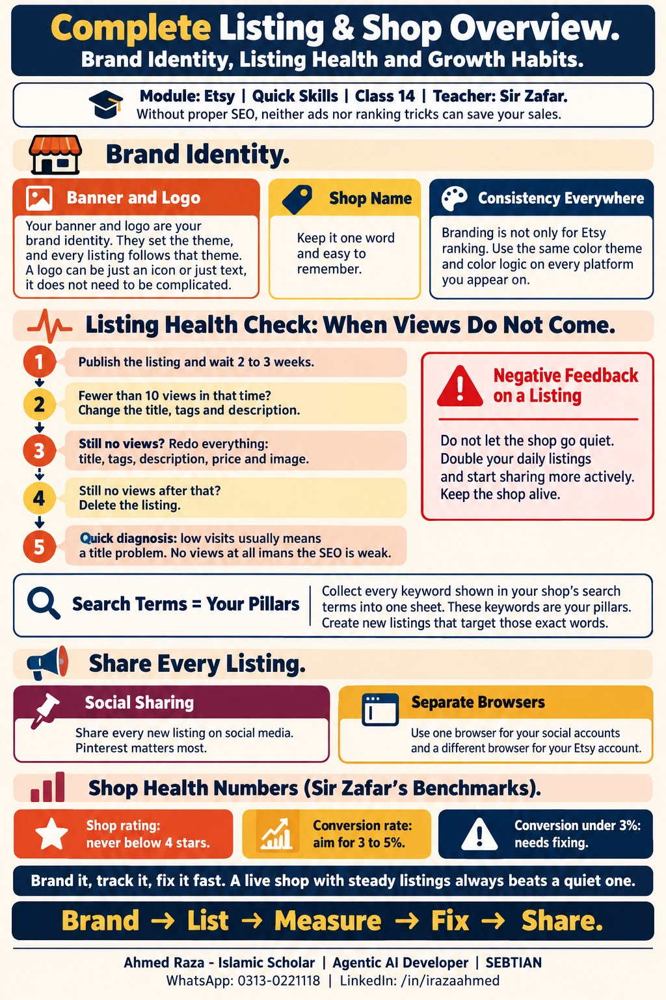

*This whole document is from Class 14 of the Etsy module, Complete Listing
and Shop Overview, taught by Sir Zafar.*

If you are not doing proper **SEO**, then neither **ads** nor **ranking**
will be able to get you a sale.[^etsy-class-14]

## Brand identity

- **Banner and logo:** your Etsy shop's banner and logo are its **brand
  identity**. They are your **theme**, and your listings follow that same
  theme.
- **Logo:** a logo is only an **icon** or **text**. It does not carry a lot
  of matter.
- **Shop name:** keep it **one word**, and a name that is **easy to
  remember**.
- **Branding everywhere:** branding is not only for ranking on Etsy. Do it
  for every place you appear. The **color theme** and **color logic**, every
  single thing matters.[^etsy-class-14]

## Listing health: when views do not come

If views are not coming, your **SEO** is not good.[^etsy-class-14]

1. After you publish a listing, wait **2 to 3 weeks**.
2. If it does not get even **10 views** in that time, change the **title**,
   **tags** and **description**.
3. If views still do not come after that, redo everything: **title**,
   **tags**, **description**, **price** and **image**.
4. If views still do not come, **delete the listing**.[^etsy-class-14]

If **visits** are low, the problem is in the **title**.[^etsy-class-14]

## Negative feedback on a listing

If a listing gets **negative feedback**, **double** your listings per day and
start **sharing**. Do not let the shop go dead.[^etsy-class-14]

## Search terms are your pillars

Take every keyword that shows up in your shop's **search terms** into one
sheet. Target those words and make **new listings** for them. The keywords
that show in your search terms are your **pillars**.[^etsy-class-14]

## Share every listing

- Whatever you list, you must **share it on social media**, and above all
  you must share it on **Pinterest**.
- Run your **social accounts** and your **Etsy account** in **separate
  browsers**.[^etsy-class-14]

## Shop health numbers

Sir Zafar's benchmarks for a healthy shop:[^etsy-class-14]

| Metric | Benchmark |
| --- | --- |
| Shop rating | Never below 4 |
| Conversion rate | 3 to 5% |
| Conversion rate below 3 | Bad, needs fixing |

[^etsy-class-14]: iSkills Quick Skills (Etsy) Class 14 notes, Complete
    Listing and Shop Overview, taught by Sir Zafar.

## Class infographic

