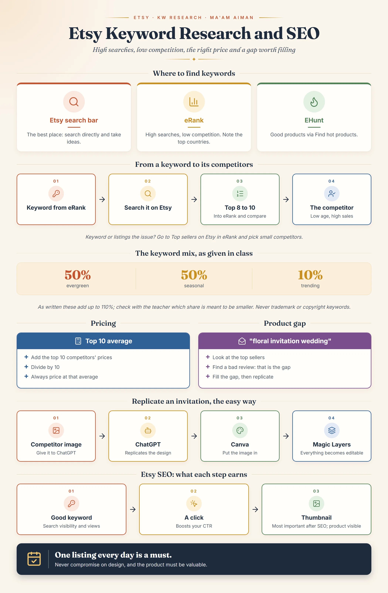

*This document records the KW Research class of the Etsy module, taught by
Ma'am Aiman.*

## Where to find keywords

- **The Etsy search bar** is the best place for Etsy keywords: search
  directly in it and take ideas from what it
  suggests.[^etsy-kw-research-aiman]
- **eRank** works for keyword research too. In it, do not just look at
  keywords: look for keywords with **high searches and low
  competition**.[^etsy-kw-research-aiman]
- Alongside each keyword, **note down the countries**: which country
  sends the most traffic.[^etsy-kw-research-aiman]
- Good products can also be found in **EHunt**, through its **Find hot
  products** option.[^etsy-kw-research-aiman]

The search bar method is the same autocomplete idea taught in
[Finding Etsy keywords in bulk](etsy-keyword-research-in-bulk.md): type a
word, then read the suggestions.

## From a keyword to its competitors

1. Take the keyword out of **eRank**.
2. **Search it on Etsy.**
3. Put the **top 8 to 10** listings into **eRank** and **compare** them.

**Who counts as a competitor:** the seller whose **age is low and sales are
high**.[^etsy-kw-research-aiman] (The notes write "agr kam"; this record
reads it as *age* kam, a newer seller, which matches the shop criteria in
[RankKW: the Etsy SEO tool and shop criteria](etsy-rankkw-tool-and-listing-criteria.md).
Confirm with the class if it meant something else.)

**If the keyword or the listings are the issue**, go straight to **Top
sellers on Etsy** in eRank and pick out **small
competitors**.[^etsy-kw-research-aiman]

## The keyword mix: evergreen, seasonal and trending

Find your own **seasonal**, **trending** and **evergreen** keywords, then
split the work between them as the class gives it:[^etsy-kw-research-aiman]

| Keyword type | Share of your work |
| --- | --- |
| Evergreen | 50% |
| Seasonal | 50% |
| Trending | 10% |

> [!NOTE]
> As written, these shares add up to 110%, not 100%. The figures are
> recorded exactly as given in the notes; check with Ma'am Aiman which
> share was meant to be smaller.

**Never work on trademark or copyright keywords.**[^etsy-kw-research-aiman]
Why that matters on Etsy is covered in
[Etsy keyword research, clearing the confusion](etsy-keyword-research-clear-all-confusion.md).

## Pricing: the top 10 average

Always keep your price at the **average of your top competitors**: add up
the prices of the **top 10 competitors** and divide by
**10**.[^etsy-kw-research-aiman]

For example, if the top 10 listings sell at $4, $5, $5, $6, $6, $6, $7,
$7, $8 and $8, the total is $62, and your price is $62 ÷ 10 = **$6.20**.
(This worked example is added by this record to show the arithmetic; the
prices are illustrative, not from the class.)

## Find the product gap, then replicate

Look for the **product gap** as well. The class example:

1. **Invitation** is a niche. Search it.
2. Look at one of its keywords: **"floral invitation wedding"**.
3. Look at the **top sellers** for it, and look for any **bad review**.
4. A bad review shows the **gap** the seller left. **Fill that gap**, and
   **replicate** the product.[^etsy-kw-research-aiman]

### The easy way to replicate an invitation

1. Give a competitor's image to **ChatGPT** and have it **replicate** the
   design.
2. Put that image into **Canva**.
3. Use **Magic Layers** to make it **editable**. Then everything becomes
   editable.[^etsy-kw-research-aiman]

> [!WARNING]
> Replicate the *gap* and the idea, not someone's artwork. The design you
> list must be your own, and AI use should be disclosed where Etsy asks,
> as covered in
> [Canva course: invitations and planners](../products-to-sell/canva-course-invitations-and-planners.md).

## Etsy SEO: from keyword to ranking

The class traces what each step earns:[^etsy-kw-research-aiman]

1. **A good keyword** brings you into **search visibility**, and you get
   **views**.
2. **A click** on your listing **boosts your CTR**.
3. **After SEO, the thumbnail** is the most important thing for ranking.
   Make the thumbnail good, and keep the **product visible** in it.

This is the same chain as
[the Etsy ranking funnel](../ranking-and-growth/etsy-ranking-funnel-and-pro-tips.md):
impressions, then clicks, then sales.

## Daily habits

- **One listing every day** is a must.
- **Never compromise on design**, and the product must be
  **valuable**.[^etsy-kw-research-aiman]

## Class infographic

[^etsy-kw-research-aiman]: Etsy KW Research class notes, taught by Ma'am
    Aiman, supplied by the record's owner on 2026-11-17.
