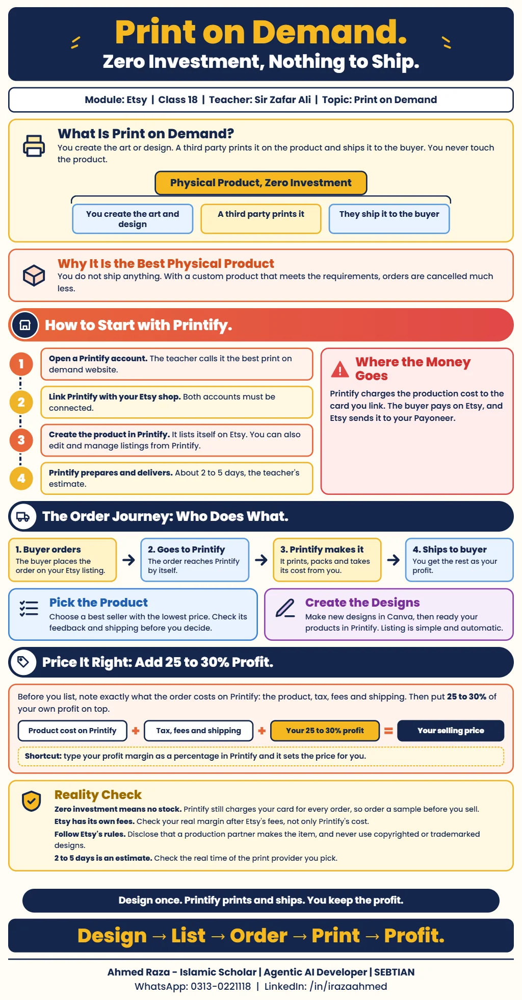

*This document records Class 18 of the Etsy module, Print on Demand, taught
by Sir Zafar Ali.*[^etsy-class-18]

## What print on demand is

Print on demand is the **zero investment** way to sell a physical product.
You create the artwork and design; a third party prints it and ships
it.[^etsy-class-18]

The class calls it the best product because you do not have to ship it
yourself. If your product is custom and you properly meet the requirements,
your orders do not get cancelled.[^etsy-class-18] The notes do not list which
requirements these are.

[Class 17](etsy-shop-and-products.md) already said one shop can carry digital,
physical and print on demand products together; this class shows how print on
demand works.

## How to start with Printify

1. The best print on demand website, according to the class, is
   **Printify**.
2. You need a Printify account, and you link it with your Etsy shop.
3. Through Printify you can manage your Etsy account's listings: create them,
   edit them and so on.
4. Printify prepares and delivers an order in **2 to 5 days**.[^etsy-class-18]

The infographic marks 2 to 5 days as the teacher's estimate and suggests
checking the real time of the print provider you
pick.[^etsy-class-18-infographic]

## How an order and the money move

1. The buyer places an order on Etsy.
2. The order goes to Printify.
3. Printify makes it ready and ships it.
4. Printify takes its money, and the rest of the amount comes to
   you.[^etsy-class-18]

You use Printify to create the product, and your card is linked to it. The
payment for making the product is cut from **your card**. What the buyer pays
goes into **your Etsy account**, and from Etsy it comes to you in
**Payoneer**.[^etsy-class-18] For setting up Payoneer, see
[Creating a Payoneer account](../getting-started/payoneer-account-creation.md).

> [!NOTE]
> The notes say both that Printify "takes its money" from the order and that
> the production cost is charged to your linked card. Read together, the cost
> is charged to your card while the buyer's payment reaches you through Etsy
> and Payoneer; the notes do not explain the exact timing of each charge.

## Choosing the product

On Printify, take the product from a provider who is a **best seller** with
the **lowest price**, and check everything: feedback and shipping. Then look
at it carefully before you decide.[^etsy-class-18]

## Designs and listing

- Have new designs made in **Canva** for Printify, and get your products
  ready.
- The working is very simple: the listing happens **automatically**.
- Write your profit margin as a **percentage**, and Printify sets the price
  itself.[^etsy-class-18]

## Pricing: add 25 to 30% profit

Before you list, note exactly what the order costs on Printify: the product,
tax, fees and shipment. On top of all of that, keep **25 to 30%** as your own
profit.[^etsy-class-18]

| Product cost on Printify | + Tax, fees and shipping | + Your 25 to 30% profit | = Your selling price |
| --- | --- | --- | --- |

The notes do not say whether Etsy's own fees should be counted in this cost.

## Reality check

The infographic adds cautions that are not in the class notes:

- Zero investment means no stock, but Printify still charges your card for
  every order, so order a sample before you sell.
- Etsy has its own fees; check your real margin after Etsy's fees, not only
  Printify's cost.
- Follow Etsy's rules: disclose that a production partner makes the item, and
  never use copyrighted or trademarked
  designs.[^etsy-class-18-infographic]

[^etsy-class-18]: Class 18 notes supplied by Ahmed Raza on 2026-11-06, Etsy
    module, Print on Demand, taught by Sir Zafar Ali.

[^etsy-class-18-infographic]: Print on Demand infographic, supplied by Ahmed
    Raza on 2026-11-06.

## Class infographic

