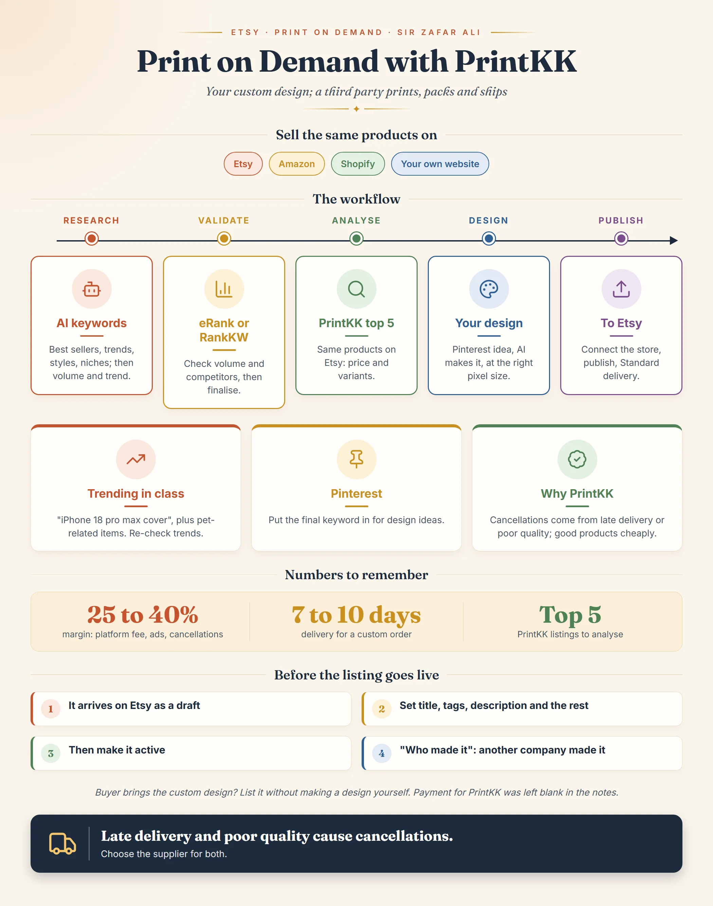

*This document records a Print on Demand class of the Etsy module, taught by
Sir Zafar Ali. It follows
[Print on demand on Etsy with Printify](etsy-print-on-demand-printify.md),
and this time the class works with PrintKK.*

## What print on demand is

Print on demand (POD) is a **business model** on Etsy: you make **custom
designs**, list them on Etsy and sell them. A **third party** puts your
design on the product, **packs** it, gets it ready and **ships**
it.[^etsy-pod-printkk]

It is not only for Etsy: the same products can also be sold on **Amazon**,
**Shopify** and **your own website**.[^etsy-pod-printkk]

## Step 1: find the best keywords with AI

Before starting POD work, find the best keywords. Take AI's help with this
prompt from the class (put your own product in place of
*t-shirt*):[^etsy-pod-printkk]

```text
analyze current best selling [t-shirt] design on etsy, amazon and social media platforms like instagram, tiktok and pinterest etc, include trends, keywords, styles and niches that are currently performing best
```

Then have the AI pull out **search volume and trend**, and analyse
them.[^etsy-pod-printkk]

- At the time of the class, the best trending keyword was **"iPhone 18 pro
  max cover"**. In the same way, **pet-related** items and designs also
  sell.[^etsy-pod-printkk] Trends move, so re-check before you rely on
  either.
- Take keywords out of **Claude** or **ChatGPT**, then check their
  **volume** and **competitors** in **eRank** or **RankKW** before you
  finalise them.[^etsy-pod-printkk]
- Put the final keyword into **Pinterest** and take **design ideas** from
  there.[^etsy-pod-printkk]

## Step 2: analyse the product on PrintKK

**PrintKK** (printkk.com) is a print on demand website that can customise
products for you.[^etsy-pod-printkk]

1. Search your final keyword on **PrintKK**.
2. Open the **top 5 listings** and analyse them.
3. Open the same products on **Etsy** too, and check everything: at what
   price they are selling, and in how many **variants**.[^etsy-pod-printkk]

### Why the supplier matters

In POD, **order cancellations** happen when a delivery is **late** or the
**quality is not good**. According to the class, PrintKK gives good
products for little money.[^etsy-pod-printkk]

## Step 3: pricing, with a 25 to 40% margin

Whatever you work on, physical products, POD, drop shipping or wholesale,
keep **25 to 40%** as your margin, because the price has to cover the
**platform fee**, the **ads fee**, the **average of cancellations** and
everything else.[^etsy-pod-printkk]

> [!NOTE]
> The Printify class gave **25 to 30%** profit on top of the product,
> tax, fees and shipping. This class gives **25 to 40%** and counts
> platform fees, ads and cancellations inside it. Both figures are
> recorded as taught.

## Step 4: put your design on the product

1. On the product you finalise, you will put **your own custom design**.
   Note down the **recommended pixel size** for it.
2. Take a design idea from **Pinterest**.
3. Have **AI** make the design, finalise it, and put it on the
   product.[^etsy-pod-printkk]

**Selling a product the buyer personalises?** If the product is sold with
the buyer's own custom design, do not make any design yourself: you can
list it without a design.[^etsy-pod-printkk]

## Step 5: connect Etsy and publish

1. Finalise the design on **PrintKK**.
2. **Connect your Etsy store** to PrintKK and **publish** to your store.
3. For delivery, choose the **Standard** option.
4. The listing arrives on Etsy as a **draft**. Set the **title**, **tags**,
   **description** and everything else first, then make it
   **active**.[^etsy-pod-printkk]
5. In **"Who made it"**, state that **another company** made the
   product.[^etsy-pod-printkk]

**Custom orders** have to be delivered in **7 to 10
days**.[^etsy-pod-printkk]

For writing the title, tags and description of that draft, see
[Etsy SEO: the ranking formula and keyword layering](../listings-and-images/etsy-seo-ranking-formula-and-keyword-layering.md).

## Open question: payment

The notes have a heading for **how payment works** with PrintKK, but
nothing is written under it. Until it is filled in, the money flow
described for Printify (production cost on your card, buyer's payment
through Etsy to Payoneer) is in
[the Printify class](etsy-print-on-demand-printify.md); whether PrintKK
works the same way is not in these notes.

## Class infographic



[^etsy-pod-printkk]: Etsy Print on Demand class notes, taught by Sir Zafar
    Ali, supplied by the record's owner on 2026-11-17.
